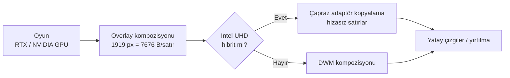

# NVIDIA Overlay Fix

[](#uyumluluk)
[](#gereksinimler)
[](#sürüm-geçmişi)
[](LICENSE)

> **NVIDIA App oyun içi overlay bozulması** (yatay çizgiler, parçalanma, kaymış yazılar) için tek dosyalık Windows düzeltme aracı.

NVIDIA App'in oyun içi overlay'i bazı sistemlerde — özellikle **hibrit grafikli (Optimus) laptoplerde** — oyunlarda yatay çizgili/parçalı çizilir. Masaüstünde düzgündür, oyuna girince bozulur. Bu araç, sorunun kök nedenini (overlay yüzeyinin 1 piksel daraltılması) kapatır ve gerekli Windows ayarlarını tek tıkla uygular.

> ⚠️ Bu proje **NVIDIA ile resmi bir bağlantıya sahip değildir.** Topluluk tarafından geliştirilmiş, açık kaynak bir düzeltme aracıdır.

---

## İçindekiler

- [Hızlı başlangıç](#hızlı-başlangıç)
- [Sorun nedir?](#sorun-nedir)
- [Belirtiler](#belirtiler)
- [Kök neden](#kök-neden)
- [Görsel kanıt](#görsel-kanıt)
- [Neden bilinen çözümler işe yaramıyor?](#neden-bilinen-çözümler-işe-yaramıyor)
- [Çözüm: araç ne yapıyor?](#çözüm-araç-ne-yapıyor)
- [Özellikler](#özellikler)
- [Gereksinimler](#gereksinimler)
- [Kurulum](#kurulum)
- [Kullanım](#kullanım)
- [Doğrulama](#doğrulama)
- [Geri alma](#geri-alma)
- [Ne değişiyor? (teknik detay)](#ne-değişiyor-teknik-detay)
- [SSS](#sss)
- [Sınırlamalar](#sınırlamalar)
- [Uyumluluk](#uyumluluk)
- [Sorun bildirme](#sorun-bildirme)
- [Geliştiriciler için](#geliştiriciler-için)
- [Yol haritası](#yol-haritası)
- [Katkı](#katkı)
- [Lisans](#lisans)
- [Referanslar](#referanslar)
- [English](#english)

---

## Hızlı başlangıç

```text
1. NVIDIA_Overlay_Fix.cmd dosyasını indir.
2. Çift tıkla -> UAC izni ver.
3. Menüden 1'i seç (TANI + DÜZELT).
4. Bilgisayarı yeniden başlat.
5. Oyunda Alt+Z / Alt+F3 / Alt+R ile test et.
```

Sorun devam ederse:

```text
6. Aracı tekrar aç, menüden 2'yi seç (sadece rapor).
7. Masaüstüne düşen NVIDIA_Overlay_Rapor_<tarih>.txt dosyasını paylaş.
```

Hiçbir kurulum, Python, .NET SDK veya harici program gerekmez. Windows ile gelen PowerShell yeterlidir.

---

## Sorun nedir?

NVIDIA App (yeni uygulama, GeForce Experience değil) oyun içi overlay'i kendi ayrı penceresinde (offscreen window) çizer ve oyunun karesinin üzerine bindirir.

Bu overlay yüzeyi, NVIDIA'nın uzaktan yapılandırmasıyla **ekran genişliğinden 1 piksel dar** oluşturuluyor:

```text
1920 x 1080 ekran  ->  overlay yüzeyi 1919 x 1080
```

Bu 1 piksel, satır aralığının (row pitch / stride) 256 baytlık hizasını bozar. Overlay katmanı oyun karesine kopyalanırken satırlar kayar ve tam olarak şu görüntü ortaya çıkar:

- Yatay çizgiler
- Metinlerde yırtılma / kayma
- Overlay kutusunun parçalanması
- Renk bozulmaları

**Oyunun kendi görüntüsü sağlamdır.** Bozulan tek şey overlay katmanıdır. Bu yüzden sorun her oyunda görülür.

### Bu bir donanım arızası değildir

Aynı belirtiye sahip kullanıcılar şunları denemiş ve **çözememiştir**:

- DDU ile temiz sürücü kurulumu
- NVIDIA App'i yeniden kurma
- Oyunu yeniden kurma
- V-Sync / G-Sync ayarları
- Windows'u yeniden kurma

Sorun yazılım yapılandırmasındadır, ekran kartında değil.

---

## Belirtiler

Aşağıdakilerden birkaçı sende varsa bu araç uygun olabilir:

- [x] Overlay masaüstünde düzgün, **oyunda bozuk**
- [x] Yatay çizgiler / tarama çizgileri
- [x] Overlay yazıları (FPS, GPU, CPU, gecikme) yırtılmış veya kaymış
- [x] Overlay kutusunun kenarları parçalı
- [x] Sorun **sürücü güncellemesinden sonra** başladı
- [x] Her oyunda oluyor, tek bir oyuna özel değil
- [x] Ekran kartı sıcaklığı ve performansı normal
- [x] Masaüstü / pencere modunda sorun yok veya daha az

---

## Kök neden

### 1) Satır hizası (row pitch) hesabı

Bir görüntü yüzeyinde her satır `genişlik × 4 bayt` (BGRA) yer kaplar. GPU kopyalama işlemleri bu değerin **256 bayta tam bölünmesini** tercih eder.

| Genişlik | Satır aralığı | 256'ya bölüm | Sonuç |
|---:|---:|---:|---|
| **1920** | 1920 × 4 = **7680** | 30 | ✅ Hizalı |
| **1919** | 1919 × 4 = **7676** | 29,98 | ❌ Hizasız |
| 2560 | 2560 × 4 = 10240 | 40 | ✅ Hizalı |
| 2559 | 2559 × 4 = 10236 | 39,98 | ❌ Hizasız |
| 3840 | 3840 × 4 = 15360 | 60 | ✅ Hizalı |
| 3839 | 3839 × 4 = 15356 | 59,98 | ❌ Hizasız |

Yani kural basit: **genişlik tek sayıya düşerse satır hizası bozulur.** 1920 → 1919, 2560 → 2559, 3840 → 3839 aynı etkiyi yapar. Bu yüzden sorun çözünürlükten bağımsızdır.

### 2) Hibrit grafik (Optimus) etkisi

Ekranı Intel UHD sürüyorsa ve oyun NVIDIA GPU'da çalışıyorsa, overlay katmanı **çapraz adaptör** üzerinden birleştirilir. Hizasız kopyalama bu yolda daha da belirgin hale gelir.

Overlay logunda bu durum şöyle görünür:

```text
initializing d3d11 to: 1919x1080 and hybrid: 1
```

### 3) HDR etkisi

HDR açıkken overlay'in HDR yolu da devreye girer ve hata payı artar:

```text
"hdrMode": 1
GetAIHDRDisplayInfoForProcess failed ReturnCode 1
```

HDR tek başına sorunun nedeni değildir ama bozulmayı tetikleyebilir. Bu yüzden araç, HDR'yi otomatik kapatmaz; menüden ayar sayfasını açar ve raporda uyarır.

### 4) Uzaktan yapılandırma

`nv-osc-width` anahtarı NVIDIA'nın sunucu tarafındaki `oscWidthReduction` ayarıyla yazılır:

```json
{"switches":["nv-combine-processes=false","nv-osc-width=true"]}
```

Bu dosya:

```text
%LOCALAPPDATA%\NVIDIA Corporation\NVIDIA Overlay\overrides.json
```

Ayar herkese aynı anda dağıtılmadığı için bazı kullanıcılarda sorun hiç oluşmaz, bazılarında ise sürücü güncellemesinden sonra ortaya çıkar.

### Özet akış



---

## Görsel kanıt

Sorunun gerçek dünyadaki örneği (Reddit, Ekim 2026):

- Gönderi: [Nvidia overlay glitching out — r/GeForceExperience](https://www.reddit.com/r/GeForceExperience/comments/1xceg7z/nvidia_overlay_glitching_out/)
- 12 kullanıcı aynı belirtiyi bildirdi (RTX 3050, 4050, 4070, 5070)
- Tek önerilen "çözüm": **eski sürücüye dönmek**
- DDU ile temiz kurulum bile sorunu çözmedi

Bu depoya kendi ekran görüntülerinizi eklemek için:

```text
docs/before.png   -> düzeltme öncesi bozuk overlay
docs/after.png    -> düzeltme sonrası düzgün overlay
```

```markdown


```

---

## Neden bilinen çözümler işe yaramıyor?

| Denenen çözüm | Neden işe yaramıyor |
|---|---|
| **DDU ile temiz kurulum** | Sorun sürücü dosyalarında değil, overlay yapılandırmasında |
| **NVIDIA App'i yeniden kurma** | `overrides.json` kullanıcı profilinde kalır, silinmez |
| **Oyunu yeniden kurma** | Overlay oyundan bağımsız, ayrı bir süreçtir |
| **V-Sync / G-Sync** | Yırtılma değil, yanlış satır aralığı sorunu |
| **Eski sürücüye dönme** | Geçici çözüm; yeni sürücüde hata geri gelir |
| **Overlay'i kapatma** | Sorunu gizler, çözmez |
| **Windows'u yeniden kurma** | Ayar ilk overlay açılışında tekrar yazılır |

---

## Çözüm: araç ne yapıyor?

Araç dört değişikliği birlikte uygular. Hepsi geri alınabilir.

| # | Değişiklik | Amaç |
|---|---|---|
| 1 | `nv-osc-width=false` | 1 piksel daraltmayı kapatır (asıl çözüm) |
| 2 | `OverlayTestMode = 5` | MPO'yu kapatır, kompozisyonu tek yola indirir |
| 3 | `HwSchMode = 1` | HAGS'i kapatır (hibrit sistemlerde ek güvenlik) |
| 4 | `GpuPreference=2;` | Overlay'i yüksek performanslı GPU'ya atar |

### Herkeste aynı etkiyi vermez

- **Masaüstü sistemlerde** genellikle 1. adım yeterlidir.
- **Hibrit laptoplerde** 1 + 4 genellikle sorunu çözer.
- **İnatçı durumlarda** 2 ve 3 gerekir.

Araç bunların hepsini uygular; menü 3 ile istediğin zaman eski hâline dönebilirsin.

---

## Özellikler

- ✅ **Tek dosya** — kurulum yok, bağımlılık yok
- ✅ **Kendini yönetici olarak başlatır** (UAC)
- ✅ **Çözünürlükten bağımsız** — 1080p, 1440p, 4K, ultrawide
- ✅ **Sistem otomatik algılama** — hibrit / masaüstü, NVIDIA App yolu
- ✅ **Otomatik yedekleme** — değiştirmeden önce eski değerler kaydedilir
- ✅ **Tek tuşla geri alma** — menü 3
- ✅ **TXT rapor** — masaüstüne, paylaşılabilir
- ✅ **Paylaşım paketi** — zip + kullanım kılavuzu
- ✅ **Sessiz modlar** — `report`, `apply`, `revert`, `share`
- ✅ **Açık kaynak** — tek bir `.cmd` dosyası, incelenebilir

---

## Gereksinimler

| Gereksinim | Detay |
|---|---|
| İşletim sistemi | Windows 10 veya Windows 11 (64 bit) |
| PowerShell | Windows ile gelen 5.1 veya üzeri |
| Ekran kartı | NVIDIA GPU (araç NVIDIA App overlay'i içindir) |
| Yazılım | NVIDIA App (yeni uygulama) |
| Yetki | Yönetici (araç kendisi ister) |
| İnternet | Gerekmez |

> Not: GeForce Experience'ın eski overlay'i bu araçla düzeltilmez. Araç **yeni NVIDIA App** overlay'ini hedefler.

---

## Kurulum

### 1) İndir

Depodan `NVIDIA_Overlay_Fix.cmd` dosyasını indir.

```text
NVIDIA_Overlay_Fix.cmd
```

### 2) SmartScreen uyarısı

İmzasız bir `.cmd` dosyası olduğu için Windows şu uyarıyı gösterebilir:

> **Windows protected your PC**

Bu normaldir. Şu yolu izle:

```text
More info -> Run anyway
```

### 3) Çalıştır

Dosyaya **çift tıkla**. Yönetici izni istenir, **Evet** de.

Alternatif olarak terminalden:

```bat
NVIDIA_Overlay_Fix.cmd
```

### 4) Antivirüs notu

Bazı antivirüsler registry düzenleyen `.cmd` dosyalarını şüpheli bulabilir. Kaynak kodu açıp inceleyebilirsin:

```text
Sağ tık -> Edit / Notepad ile aç
```

Araç hiçbir dosyayı silmez, hiçbir veriyi dışarı göndermez. Tüm işlemler yereldir.

---

## Kullanım

### Menü

```text
======================================================
   NVIDIA OVERLAY FIX v2
   Oyun ici overlay bozulmasi duzeltici
======================================================
   Sistem: <ekran adaptoru> | <genislik>x<yukseklik> @ <Hz> | Hibrit: EVET/HAYIR

 1) TANI + DUZELT (onerilen, rapor olusturur)
 2) Sadece TANI / RAPOR (degisiklik yapmaz)
 3) GERI AL (eski ayarlara don)
 4) DURUM goster + rapor
 5) HDR ayarlarini ac
 6) HAGS AC (DLSS Frame Generation icin)
 7) PAYLASIM PAKETI olustur (zip + kilavuz)
 8) Cikis
```

### Menü seçenekleri

| Seçenek | Ne yapar | Yeniden başlatma |
|---|---|---|
| **1 — TANI + DÜZELT** | Dört düzeltmeyi uygular, rapor yazar | Gerekir |
| **2 — SADECE RAPOR** | Hiçbir şeyi değiştirmez, tanı raporu üretir | Gerekmez |
| **3 — GERİ AL** | Tüm değişiklikleri eski hâline döndürür | Gerekir |
| **4 — DURUM** | Mevcut ayarları gösterir, rapor yazar | Gerekmez |
| **5 — HDR** | Windows HDR ayar sayfasını açar | Gerekmez |
| **6 — HAGS AÇ** | HAGS'i geri açar, diğer düzeltmeler kalır | Gerekir |
| **7 — PAYLAŞIM** | Zip + kılavuz oluşturur | Gerekmez |
| **8 — ÇIKIŞ** | Kapatır | — |

### Sessiz (otomatik) modlar

Menüye girmeden doğrudan işlem yapmak için:

```bat
NVIDIA_Overlay_Fix.cmd report   :: sadece rapor
NVIDIA_Overlay_Fix.cmd apply    :: düzeltmeleri uygula
NVIDIA_Overlay_Fix.cmd revert   :: geri al
NVIDIA_Overlay_Fix.cmd share    :: paylaşım paketi oluştur
```

Bu modlar özellikle şunlar için uygundur:

- Uzaktan destek verirken
- Zamanlanmış görevlerde
- Kurumsal dağıtımda

### Önerilen kullanım sırası

```text
1) Menü 1  -> yeniden başlat -> test
2) Sorun sürüyor: HDR kapat (menü 5) -> test
3) Sorun sürüyor: ekran kartı sürücülerini güncelle
4) Sorun sürüyor: menü 2 ile rapor al ve paylaş
```

---

## Doğrulama

Düzeltmeden sonra overlay loglarını kontrol edebilirsin:

```text
%LOCALAPPDATA%\NVIDIA Corporation\NVIDIA Overlay\debug.log
```

### Önce (bozuk)

```text
Creating OSCWindow with reduced window size enabled
window size: 1919 1080
stream initialized to: 1919 x 1080
initializing d3d11 to: 1919x1080 and hybrid: 1
```

### Sonra (düzgün)

```text
Creating OSCWindow with reduced window size disabled
window size: 1920 1080
stream initialized to: 1920 x 1080
initializing d3d11 to: 1920x1080 and hybrid: 0
```

Üç şeye bak:

1. `reduced window size` → **disabled** olmalı
2. `window size` → tam çözünürlük olmalı (1919 değil 1920)
3. `hybrid` → **0** olmalı

---

## Geri alma

Her şeyi eski hâline döndürmek için:

```text
Menü -> 3 (GERİ AL)
```

Araç şunları geri yükler:

- HAGS (`HwSchMode`) eski değeri
- MPO (`OverlayTestMode`) eski değeri
- Overlay GPU tercihi eski değeri
- `overrides.json` yedeği

Yedek dosyası:

```text
%LOCALAPPDATA%\NVIDIAOverlayFix\state.json
```

> Yedek yoksa araç güvenli varsayılanlara döner: HAGS açık, MPO varsayılan, GPU tercihi kaldırılır.

---

## Ne değişiyor? (teknik detay)

### Registry

| Ayar | Konum | Ad | Değer |
|---|---|---|---|
| HAGS | `HKLM\SYSTEM\CurrentControlSet\Control\GraphicsDrivers` | `HwSchMode` | `1` (DWORD) |
| MPO | `HKLM\SOFTWARE\Microsoft\Windows\Dwm` | `OverlayTestMode` | `5` (DWORD) |
| GPU tercihi | `HKCU\Software\Microsoft\DirectX\UserGpuPreferences` | `<NVIDIA Overlay.exe yolu>` | `GpuPreference=2;` (String) |

### Dosyalar

| Dosya | İşlem |
|---|---|
| `%LOCALAPPDATA%\NVIDIA Corporation\NVIDIA Overlay\overrides.json` | Yedeklenir, `nv-osc-width=false` yazılır, **salt-okunur** yapılır |
| `...\overrides.json.bak` | Orijinal yedek |
| `%LOCALAPPDATA%\NVIDIAOverlayFix\state.json` | Tüm eski ayarların yedeği |
| `Masaüstü\NVIDIA_Overlay_Rapor_<tarih>.txt` | Tanı raporu |
| `Masaüstü\NVIDIA_Overlay_Fix_Paylasim.zip` | Paylaşım paketi (menü 7) |

### Neden `overrides.json` salt-okunur?

NVIDIA App, uzaktan yapılandırmayı periyodik olarak yeniden yazar. Dosya salt-okunur olmazsa `nv-osc-width=true` geri gelebilir ve sorun tekrarlar.

Geri almak istediğinde menü 3 dosyayı yedekten geri yükler ve salt-okunurluğu kaldırır.

### Rapor içeriği

Rapor şunları içerir:

- Sistem / CPU / GPU / sürücü sürümleri
- Ekran adaptörü, çözünürlük, yenileme hızı
- Hibrit grafik tespiti
- Satır hizası hesabı (senin çözünürlüğüne göre)
- HAGS / MPO / GPU tercihi durumu
- Overlay logları (son ve önceki oturum)
- HDR ve hata satırları
- Otomatik teşhis ve öneriler

---

## SSS

### Overlay'im bozuluyor ama oyun normal çalışıyor. Ekran kartım bozuk mu?

Hayır. Oyun karesi sağlam, bozulan overlay katmanı. Bu bir kompozisyon/yazılım sorunudur.

### DLSS kapanır mı?

Hayır. Araç DLSS'e dokunmaz. DLSS Super Resolution, Ray Reconstruction normal çalışır.

### DLSS Frame Generation neden kayboldu?

Çünkü araç **HAGS**'i kapatır ve DLSS Frame Generation HAGS olmadan çalışmaz. İstersen:

```text
Menü -> 6 (HAGS AÇ)
```

Bu, diğer düzeltmeleri bozmadan HAGS'i geri açar.

### MPO nedir?

**Multi-Plane Overlay** — Windows'un donanım katmanı birleştirme özelliği. NVIDIA'nın değil, Microsoft'un. MPO'yu kapatmak, hibrit grafikteki katman taşıma sorunlarını azaltır.

### Her NVIDIA kullanıcısında `overrides.json` var mı?

Hayır. Dosya, NVIDIA App overlay'i **ilk kez açıldığında** oluşur. Yoksa araç o adımı atlar ve "NVIDIA App'i bir kez aç" uyarısı verir.

### Format attıktan sonra tekrar çalıştırmam gerekir mi?

Evet, **format başına bir kez**. Normal yeniden başlatmalarda ayarlar kalır.

### Windows güncellemesinden sonra bozulur mu?

Nadiren büyük sürüm yükseltmeleri ayarları sıfırlayabilir. Böyle bir durumda aracı tekrar çalıştırmak yeterlidir.

### Masaüstü bilgisayarda çalışır mı?

Evet. Hibrit grafik olmasa bile 1 piksel genişlik azaltması sorun yaratabilir. Araç masaüstü sistemlerde de çalışır.

### 1440p / 4K / ultrawide destekleniyor mu?

Evet. Kural çözünürlükten bağımsızdır: genişlik tek sayıya düşerse satır hizası bozulur.

### Güvenli mi?

Araç:

- Hiçbir dosyayı silmez
- Hiçbir veriyi dışarı göndermez
- Tüm değişiklikleri yedekler
- Tek tuşla geri alınabilir

Yine de registry değişiklikleri içerdiği için önce **sistem geri yükleme noktası** oluşturman önerilir.

### Virüs uyarısı aldım, normal mi?

İmzasız `.cmd` dosyaları için yaygın bir durumdur. Kaynak kodu metin editörüyle açıp inceleyebilirsin. Kod tamamen açıktır.

### NVIDIA App güncellemesi sorunu geri getirir mi?

`overrides.json` salt-okunur olduğu için NVIDIA App ayarı geri yazamaz. Yine de büyük güncellemelerden sonra kontrol etmekte fayda var.

### Sorun devam ediyor, ne yapmalıyım?

1. HDR'yi kapat (Windows + oyun içi + RTX HDR)
2. Ekran kartı sürücülerini güncelle (özellikle Intel)
3. Farklı pencere modu dene (tam ekran / kenarlıksız)
4. Yenileme hızını 60 Hz yapıp dene
5. Menü 2 ile rapor al ve paylaş

---

## Sınırlamalar

- Her overlay bozulması bu nedenden kaynaklanmaz. Farklı bir hata varsa araç çözmeyebilir; yine de rapor tanı sağlar.
- HAGS kapatıldığında DLSS Frame Generation devre dışı kalır (menü 6 ile geri alınır).
- Araç yalnızca **yeni NVIDIA App** overlay'ini hedefler; eski GeForce Experience overlay'i kapsam dışıdır.
- `overrides.json` salt-okunur yapıldığı için bazı NVIDIA App sürümleri ayarı güncelleyemediğini bildirebilir; bu beklenen davranıştır.
- NVIDIA App hiç açılmamışsa genişlik düzeltmesi atlanır.
- Yönetici yetkisi gerektirir.

---

## Uyumluluk

| Sistem | Durum | Not |
|---|---|---|
| Windows 11 + NVIDIA App | ✅ Destekleniyor | Ana hedef |
| Windows 10 + NVIDIA App | ✅ Destekleniyor | PowerShell 5.1 yeterli |
| Hibrit laptop (Intel + NVIDIA) | ✅ Önerilir | En çok fayda gören grup |
| Hibrit laptop (AMD + NVIDIA) | ✅ Çalışır | Tespit otomatik |
| Masaüstü + NVIDIA | ✅ Çalışır | Genellikle 1. adım yeterli |
| Sadece NVIDIA sürücüsü (App yok) | ⚠️ Kısmi | Overlay yoksa etkisiz |
| GeForce Experience | ❌ Desteklenmiyor | Farklı overlay |
| AMD / Intel only | ❌ Desteklenmiyor | NVIDIA overlay yok |

---

## Sorun bildirme

Issue açarken şunları ekle:

### 1) Rapor dosyası

```text
Menü -> 2 (Sadece rapor)
Masaüstü -> NVIDIA_Overlay_Rapor_<tarih>.txt
```

### 2) Şu bilgiler

- Overlay hangi oyunda / oyunlarda bozuluyor
- Çözünürlük ve yenileme hızı
- Windows sürümü
- NVIDIA sürücü sürümü
- Laptop mu masaüstü mü
- Sorun ne zaman başladı (güncelleme sonrası mı)
- Denediğin çözümler

### 3) İsteğe bağlı

- Ekran görüntüsü / kısa video
- `debug.log` ilgili satırları

> Raporda kişisel veri yoktur; kullanıcı adı ve bilgisayar adı dışında sistem bilgisi içerir.

---

## Geliştiriciler için

### Depo yapısı

```text
.
├─ NVIDIA_Overlay_Fix.cmd   # Tek dosyalık araç (batch + PowerShell polyglot)
├─ README.md                # Bu dosya
├─ LICENSE                  # MIT
└─ docs/
   ├─ before.png            # (opsiyonel) önce
   └─ after.png             # (opsiyonel) sonra
```

### Nasıl tek dosya çalışıyor?

Dosya iki dillidir:

```text
@echo off
... batch: UAC yükseltme, argüman aktarma ...
#PSSTART
... PowerShell: tüm mantık ...
```

1. `.cmd` olarak çalıştırıldığında `cmd.exe` ilk bölümü yürütür.
2. Yönetici değilse `Start-Process -Verb RunAs` ile kendini yeniden başlatır.
3. Ardından PowerShell, dosyayı **kendisi okur**, `#PSSTART` işaretinden sonrasını alır ve `iex` ile çalıştırır.

Avantajı: geçici dosya yok, tek dosya taşınabilir, kurulum yok.

### Ana fonksiyonlar

| Fonksiyon | Görev |
|---|---|
| `Get-SystemInfo` | GPU, ekran, hibrit tespiti |
| `Find-OverlayExe` | NVIDIA App yolunu bulma |
| `Get-Report` | Tam tanı raporu |
| `Add-Diagnosis` | Otomatik teşhis ve öneri |
| `Apply-Fixes` | Düzeltmeleri uygular |
| `Revert-Fixes` | Geri alır |
| `Enable-Hags` | HAGS'i geri açar |
| `New-SharePackage` | Zip + kılavuz |
| `Save-Report` | Raporu masaüstüne yazar |

### Tasarım kararları

- **Fail-safe:** Her adım `try/catch` ile korunur; bir adım başarısız olursa diğerleri devam eder.
- **Idempotent:** Aynı işlem birden çok kez çalıştırılabilir; yedek varsa korunur.
- **Geri alınabilir:** Tüm değişiklikler `state.json` içinde saklanır.
- **Dinamik:** Sabit çözünürlük, marka veya model yok.

### Katkı yaparken

- PowerShell 5.1 uyumluluğunu koru (PS 7'ye özel sözdizimi kullanma).
- Türkçe karakterleri konsol çıktısında kullanma (kodlama sorunları).
- Yeni bir ayar ekliyorsan `Revert-Fixes` içine de ekle.
- Test ettiğin Windows sürümünü ve GPU modelini PR açıklamasına yaz.

---

## Yol haritası

- [ ] Zamanlanmış görev ile otomatik onarım
- [ ] Basit GUI (WPF)
- [ ] Çoklu dil (TR / EN / DE)
- [ ] HDR'yi otomatik kapatma seçeneği
- [ ] NVIDIA App sürümüne göre özel tespit
- [ ] Otomatik sürücü sürümü kontrolü
- [ ] Test matrisi (farklı GPU / çözünürlük)
- [ ] İmzalı yayın (code signing)

---

## Sürüm geçmişi

### v2.0

- Çözünürlükten bağımsız hale getirildi
- Sistem / GPU / hibrit otomatik tespiti
- Dinamik tanı raporu ve satır hizası hesabı
- Paylaşım paketi (zip + kılavuz)
- Sessiz modlar: `report`, `apply`, `revert`, `share`
- Overlay yolu otomatik bulma
- HAGS'i geri açma seçeneği (DLSS Frame Generation)
- Tek elemanlı JSON dizisi hatası düzeltildi
- `overrides.json` yazma öncesi salt-okunurluk kaldırma düzeltmesi

### v1.0

- İlk sürüm
- HAGS + MPO kapatma
- `nv-osc-width=false`
- GPU tercihi
- Rapor ve geri alma

---

## Katkı

Katkılar memnuniyetle karşılanır.

```text
1. Fork'la
2. Yeni bir branch aç:  feature/yeni-ozellik
3. Değişikliğini yap
4. Test et (Windows 10 ve 11)
5. Pull request aç
```

Lütfen PR açıklamasında şunları belirt:

- Ne değişti
- Neden değişti
- Hangi sistemde test edildi

---

## Lisans

Bu proje **MIT Lisansı** ile lisanslanmıştır. Ayrıntılar için [LICENSE](LICENSE) dosyasına bak.

```text
İzin verilir: kullanım, kopyalama, değiştirme, dağıtma, ticari kullanım
Koşul: lisans ve telif bildirimi korunmalı
Garanti: yok
```

---

## Referanslar

- [NVIDIA App — resmi sayfa](https://www.nvidia.com/en-us/software/nvidia-app/)
- [NVIDIA App In-Game Performance and Latency Overlay (resmi destek)](https://nvidia.custhelp.com/app/answers/detail/a_id/5084/~/nvidia-app-in-game-performance-and-latency-overlay)
- [Nvidia overlay glitching out — r/GeForceExperience](https://www.reddit.com/r/GeForceExperience/comments/1xceg7z/nvidia_overlay_glitching_out/)

### İlgili terimler

```text
NVIDIA App overlay horizontal lines
NVIDIA overlay glitching in games
oscWidthReduction
nv-osc-width
reduced window size
1919x1080 overlay
hybrid: 1 overlay
MPO OverlayTestMode 5
HAGS HwSchMode DLSS Frame Generation
```

---

## English

### NVIDIA Overlay Fix

A single-file Windows tool that fixes **corrupted NVIDIA App in-game overlay** (horizontal lines, tearing, shifted text) — most commonly on hybrid-graphics (Optimus) laptops, but also on desktops.

**Root cause:** the overlay surface is rendered 1 pixel narrower than the display (e.g. 1920 → 1919). That makes the row pitch misaligned (1919 × 4 = 7676 bytes, not divisible by 256), so the overlay layer is composited with shifted rows.

**What it does:**

1. Disables the 1-pixel width reduction (`nv-osc-width=false`)
2. Disables MPO (`OverlayTestMode = 5`)
3. Disables HAGS (`HwSchMode = 1`)
4. Assigns `NVIDIA Overlay.exe` to the high-performance GPU

**Usage:**

```text
1. Download NVIDIA_Overlay_Fix.cmd
2. Double-click and accept the UAC prompt
3. Choose 1 (diagnose + fix)
4. Reboot
5. Test with Alt+Z / Alt+F3 / Alt+R in a game
```

**Notes:**

- No installation, no dependencies, no telemetry.
- Backs up every change and can revert with menu option 3.
- Disabling HAGS disables DLSS Frame Generation; menu option 6 re-enables it.
- Resolution independent: works on 1080p, 1440p, 4K and ultrawide.
- Not affiliated with NVIDIA.

**License:** MIT

---

<p align="center">
  <sub>Bu araç NVIDIA Corporation ile ilişkili değildir. Kendi sorumluluğunuzda kullanın.</sub>
</p>
